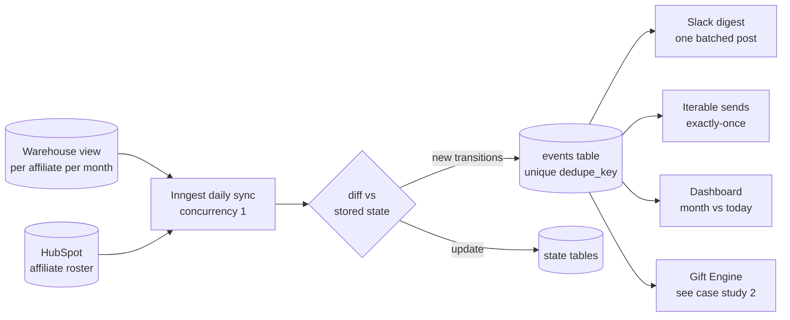

# Affiliate Lifecycle Engine

**Role:** product owner, spec author, builder, operator. **Shipped:** August 2026, then extended weekly through October. **Stack:** TypeScript, Inngest, Neon Postgres (Drizzle + neon-http), Redshift via Lightdash SQL runner, HubSpot API, Iterable, Slack.

## The problem

Posh's affiliate program had thousands of affiliates referring event organizers, and nobody could see the moments that mattered: an affiliate making their first referral, a referred organizer selling their first ticket, a referral sitting at zero revenue for two weeks, an affiliate going quiet for two months. Those transitions lived implicitly in warehouse tables that were overwritten daily. If you did not look on the right day, the moment was gone.

The August automation plan had a list of red items that all depended on knowing those moments: ping the affiliate when a referral is created, nudge when a referral is stuck, celebrate milestones. None of them could be built without an event log that did not exist.

## What I built

A daily sync that treats the warehouse and CRM as the source of truth for *current state*, diffs that against what the engine saw yesterday, and appends every transition to a durable, append-only events table. Everything downstream subscribes to that log.

**Transitions detected:** affiliate onboarded, affiliate activated (first referral), referral created, referral first revenue, referral revenue milestones, referral stuck 15 days, affiliate inactive 30 days, affiliate dormant 60 days, affiliate reactivated, monthly commission threshold crossed.

**Send layer:** events whitelisted for messaging flow to Iterable journeys as affiliate-side events. Each send is stamped on the event row itself (status plus timestamp), so a crashed run cannot send twice. A kill switch stops in-flight batches. There is a per-affiliate daily cap on referral-created pings, because one campus affiliate referred 104 student organizations in one day and would have received 104 emails.

**Weekly pulse:** a Monday-morning Slack scoreboard reporting the program's four goal metrics (time to activation, time to go-live, conversion rate, monthly engaged affiliates) computed entirely from engine tables, with week-over-week deltas.

**Dashboard:** stat cards split deliberately between *fact* dates (when something actually happened, for agreement with the warehouse) and *detection* dates (when the engine noticed, for "what happened today" and the send rail). A day picker rewinds the whole board to any of the last 14 days, which is free because the events table is append-only: a past day is a query filter, not a snapshot.

**Diagnostics:** an affiliate lookup that renders one affiliate's full engine timeline, with send outcomes and the actual error text inline. This found a whole class of silent failures (see below).

## Architecture invariants

These came out of review and are the rules the engine must not regress:

1. **Events are durable before fire-once state is updated.** If the run dies between the two writes, the next run re-detects and the unique dedupe key makes the re-insert a no-op.
2. **Seeding is gated by a marker row, never by row counts.** An empty table is not proof nothing has run.
3. **One runner.** Every sync goes through Inngest with concurrency 1. The admin "Sync now" button sends an event; it never calls the sync function directly.
4. **Flood guard.** A diff producing more events than a ceiling aborts with a per-kind breakdown and the top offenders in the error, rather than writing a thousand phantom events.
5. **Monotonic timestamps.** A "last referral at" value can only move forward.
6. **Identity renames migrate.** Affiliates are keyed by normalized name; when a name changes, the old rows migrate on account-id overlap instead of orphaning history.

## Things that went wrong, and what they taught

**The phantom flood.** A refactor added monthly-commission fields to the main constructor but not to the roster-only fallback constructor. `undefined < 500` is false in JavaScript, so the seed filter rejected them, but the detection comparison was written the other way and fired 2,241 fake "crossed $500" events on the first real run. The flood guard caught it. Fixes: explicit zeros, comparisons written as `!(x >= cap)` so undefined and NaN skip, and the API directory brought under the TypeScript gate (113 pre-existing errors fixed in one sweep, which also surfaced five other latent runtime bugs).

**Typo'd email domains.** Four affiliates had emails ending in `.con` or `.col` in the product database. Iterable rejected them permanently. One of them was the campus affiliate above: 105 failed pings, zero ever delivered, invisible because the failures panel capped at 50 rows and one affiliate filled it. Fix: a Send Issues panel grouped per affiliate with the reason inline, split into permanent / retrying / expired, with a "mark resolved" that preserves the prior status in a JSON detail column rather than overwriting it.

**Auto-clear compared the wrong timestamp.** My first version of "auto-clear a failure once a later send succeeds" compared the event's `occurred_at` (set at insert, before the send loop) with the last successful send time. A sibling ping sent seconds later hid a genuine failure forever. Rule now: compare the *failure* time, auto-clear only when a success landed on a strictly later day, and never while anything is still retrying. General lesson: in an events table, "when it happened" and "when we acted on it" are different columns.

**Postgres cannot type a parameter inside `jsonb_build_object`.** The "mark resolved" button returned a 500 on first click. TypeScript was fine; Postgres said `could not determine data type of parameter`. The pattern is extracted as [`neon-jsonb-guard`](../packages/neon-jsonb-guard).

## Review process

Every PR in this system went through a multi-agent adversarial review before merge: separate reviewers for correctness, data leaks, concurrency, and UI state, then independent refuters for each finding so false positives die before I spend time on them. A typical pass: 15 agents, 9 findings confirmed, 3 refuted. The confirmed findings above are the ones that would have shipped otherwise.

## Outcome

The engine has run daily since mid-August 2026 with one incident (the flood, same-day fix). It is the trigger brain for the messaging layer, the gift engine, the dashboards, the weekly pulse, and two incentive-program trackers. Every automation on the August roadmap that was blocked on "we can't see when this happens" is now unblocked.
