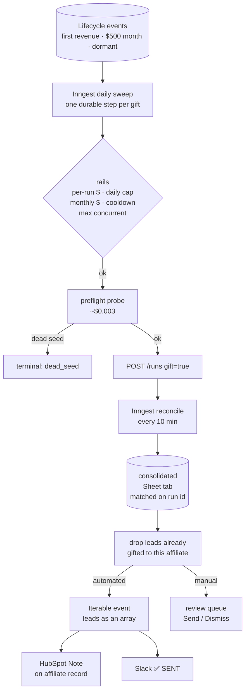

# Lead Gift Engine

**Role:** product owner, systems integrator, builder, operator, and upstream contributor to a sibling team's Python service. **Shipped:** foundations August 27 2026, first live delivery September 2, ROI readout September 10. **Stack:** TypeScript, Inngest, Neon Postgres, Google Sheets API, a third-party scraping service over HTTP, Iterable, HubSpot Notes, Slack.

## The problem

Affiliates are more likely to refer when they have warm leads. Posh already had a one-time onboarding gift: scrape an affiliate's Instagram network for event organizers and hand them four leads. But it fired once, ever, at signup, and an audit showed only about 9% of the roster had ever received leads because the scoring workflow that gated it never ran for most records.

The ask was a set of *behavioral* gifts: when an affiliate's referral sells its first ticket, send fresh leads as a congratulation. When an affiliate crosses a monthly commission threshold, same. When an affiliate goes dormant, scrape again and use the leads to win them back.

## Constraints

- The scraper was another team's Python service, deployed separately, with a shared Google Sheet as its database and a per-launcher weekly lead quota built for sales reps, not affiliates.
- Scraping costs real money per run through a third-party actor marketplace. No budget rail meant no launch.
- Leads delivered to affiliates must not pollute the sales team's pipeline, and the sales team's exclusivity rules must not block affiliate gifts.
- The scraper could only pull *who an account follows*, not who follows it.

## What I built

**Gift mode upstream.** I wrote and shipped a patch to the sibling team's Python engine (two merge requests, both merged by their owner): a `gift` flag that skips sales-rep assignment, writes to a dedicated Sheet tab invisible to their QA sweeps, disables padding from a recycled-leads pool, bypasses their global seen-store so gifts never claim leads away from sales, and relaxes their duplicate rules to "drop only if a rep actually made contact." Thirteen tests pin byte-identical behavior when the flag is absent. A second patch fixed cost sizing after I proved the actor's real rate was 40% above the assumed one, which made any run under about $15 pre-abort at zero items while reporting "private account."

**Ledger semantics.** Every gift attempt is a row with a status. Statuses are classified as *terminal* (delivered, dead seed, cooldown, refused, dismissed) or *recoverable* (budget skipped, failed, timeout, stale in-flight). The sweep re-claims only recoverable rows, and only within a 72-hour lookback. Takeover never re-scrapes money that was already spent: once a scrape finished, the row is post-scrape terminal even if delivery failed.

**Rails, all editable from the dashboard:** per-run budget, daily scan cap, monthly budget, per-seed cooldown, maximum concurrent scrapes (gated on both our ledger and the service's live-run count, failing closed if the health endpoint is unreachable).

**One Iterable journey for every gift.** Templates can only read the triggering event's fields, so the payload carries `leads` as an array and one email template renders any count with a loop. This replaced a four-branch-by-lead-count pattern in the legacy welcome flow.

**Review-first manual gifts.** A staff member can trigger a gift for any affiliate; it scrapes, parks the leads in a queue, and nothing sends until someone clicks Send.

**ROI readout.** Per-gifted-affiliate: referrals created strictly after the first gift, their GMV and commission, against total gift spend. Framed honestly in the UI as "activity after send," with no control group claimed.

## Incidents and lessons

**The service died twice under load.** A backlog campaign enrolling 135 dormant affiliates burst 11 concurrent scrapes and killed the shared scraping box twice in one afternoon, losing about $35 in half-finished runs. Fix shipped same day: a max-concurrency rail, 5-minute sleep-and-retry loops, and organic triggers always run before backlog work. Lesson I wrote down: never enforce priority by *yielding* to work that has no runner of its own. My first version did, and the backlog slept all day waiting for organics that only the once-daily sweep could start.

**"Dead handle" was the wrong diagnosis.** A wave of cheap failures looked like dead Instagram accounts. I shipped a fast-retire rule, then reverted it two days later before any affiliate was mislabeled, because the real cause was the actor marketplace's monthly usage cap throttling proxy-heavy runs to zero items while the cheap profile probe still succeeded. The lesson: when two failure modes are spend-indistinguishable, do not ship a classifier until you have an uncapped receipt.

**Org seeds follow nobody.** Scraping "who the referred organization follows" often returns nothing because promoter accounts follow few people. Operational rule: when an org seed dead-seeds, retry with the affiliate's own handle. Validated the first time it was tried: zero leads from the org seed, five relevant DJ leads from the affiliate's own network.

**Private seeds passed preflight.** The upstream preflight did not check `is_private`, so a private seed started a paid run that then refused. Fix on our side: a table of failure-log signatures mapped to terminal statuses with plain-English reasons, applied when reconciling a failed run. Upstream ask filed.

## Outcome

Gift mode went live September 2 2026. The engine runs the daily "gift trio" (first revenue, commission threshold, dormant) at roughly two or three triggers a day, a few dollars a day against the monthly budget. The backlog campaign was deliberately scrapped by the business owner once the data showed organic volume was enough. Every lead delivered is logged on the affiliate's CRM record, announced in Slack, and visible in the ROI table.
