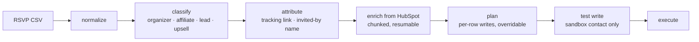

# Post-Event Flows

**Role:** process owner turned builder. **Shipped:** August 5, 2026, with follow-ups through October. **Stack:** TypeScript, Hono, React, Neon Postgres, HubSpot write API.

## The problem

After every affiliate kickoff event, someone had to take the RSVP export, figure out which attendees were already organizers on Posh, which were affiliates, which were new leads, and which were upsells, then write the right fields to the right CRM records so the right follow-up sequences would fire. I had been doing this by hand with a spreadsheet and a chat-based assistant for months. The process had a documented list of ten bugs I had personally caused along the way, including writing to the wrong CRM property name twice.

## What I built

A deterministic pipeline with a UI on the staff dashboard:

- **Pure libraries for normalize, classify, attribute, and plan**, with 62 scenario tests derived from real past exports. The spec document lists the ten historical bugs by number and each one has a test that would catch its recurrence.
- **Chunked, resumable enrichment** against the CRM so a 400-row export does not time out a serverless function.
- **Plan overrides** limited deliberately to "exclude this row" and "edit the display name," because a past bug came from a broader override that let the operator reclassify rows into states the downstream sequences could not handle.
- **Sandbox test-write** against a dummy contact before the real execute, because the real execute triggers CRM workflows that email people.
- **Scan history with inline stats:** GMV won by rows classified as qualifying organizers, deduplicated by organization, plus counts per class. Computed from the stored plan on read, so it was retroactive with no schema change.

## Change management

In October the RSVP form dropped three questions the classifier used. Rather than silently accepting the shorter export, the pipeline now treats those headers as legacy columns that can be omitted only with an explicit operator acknowledgement (an amber checkbox in the form, enforced server-side). Attribution degrades to tracking-links-only and says so. The SOP step changed on the same day as the code.

## Outcome

The flow replaced the manual process for every event since August 2026. The deliberately unported pieces (a daily wins-tracker job and a formatted spreadsheet with cell fills) were replaced by the in-app preview and a CSV export. The CRM write key was provisioned by the business, and first live runs were attended by design.
